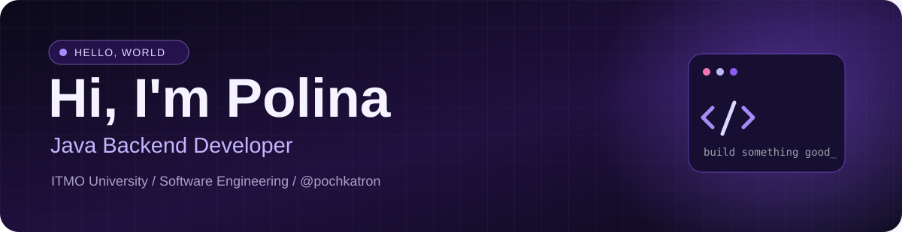

### Java Backend Developer · Software Engineering Student

**Third-year Software Engineering student at ITMO University**

I build backend applications with Java and Spring Boot, with a focus on clear architecture, reliable APIs, data persistence, and communication between services.

## About me

I'm a third-year **Software Engineering** student at **ITMO University**, currently focused on **Java backend development**. I enjoy turning business requirements into maintainable services, designing domain models, building REST APIs, and working with relational databases.

My hands-on backend experience includes developing a multi-service car dealership application. While building it, I worked with authentication and role-based access control, database migrations, asynchronous messaging, and inter-service communication. I'm interested in how these pieces fit together to create reliable systems that are easier to extend and maintain.

I care about **object-oriented design**, readable code, separation of concerns, and understanding not only how a feature works, but also why a particular architectural approach makes sense.

## Tech stack

**Core backend**

**Data and integrations**

**Tooling, security and testing**

## What I work with

- **Java & OOP:** object-oriented modelling, encapsulation, inheritance, polymorphism, interfaces, collections, exceptions, and clean separation of application responsibilities.
- **Spring ecosystem:** building REST endpoints, working with application and persistence layers, and protecting endpoints with authentication and authorization.
- **SQL & persistence:** modelling relational data in PostgreSQL, mapping entities with JPA/Hibernate, and maintaining database schema changes with Liquibase.
- **Service communication:** synchronous service-to-service calls with **gRPC** and asynchronous workflows with **RabbitMQ**.
- **Security:** integrating **Keycloak**, working with user roles and permissions, and configuring access control with Spring Security.
- **Development workflow:** Gradle builds, Docker-based environments, Git, API documentation, and automated testing using JUnit and Testcontainers.
- **Computer science fundamentals:** data structures, algorithms, software architecture, and problem solving.

### 🚘 Car Dealership Backend

[🔗 View Project on GitHub](https://github.com/pochkatron/car-dealership-backend)

A backend application for car dealership operations, designed around **two Spring Boot services**: an order service and a storage service. The application covers vehicle and parts management, orders, and related business workflows.

The project brings together REST API design, PostgreSQL persistence, secure access to application resources, and communication across service boundaries. It uses **gRPC** for service integration and **RabbitMQ** for event-driven order processing, with **Docker Compose** for the supporting infrastructure.

**Highlights:**
- Domain models and REST endpoints for dealership workflows
- PostgreSQL with Spring Data JPA / Hibernate and Liquibase migrations
- Role-based authorization using Spring Security and Keycloak
- gRPC service integration and RabbitMQ event messaging
- Gradle multi-module build and automated test tooling

> Repository link will be added here after the public portfolio copy is published.

## What I'm focusing on

I'm strengthening my Java Core knowledge, exploring backend and distributed-system design, and improving my skills in writing maintainable code and testing application behavior. I'm particularly interested in **Java Backend internship opportunities** where I can contribute to real projects and keep developing as an engineer.

---

**Thanks for stopping by! 💜**

